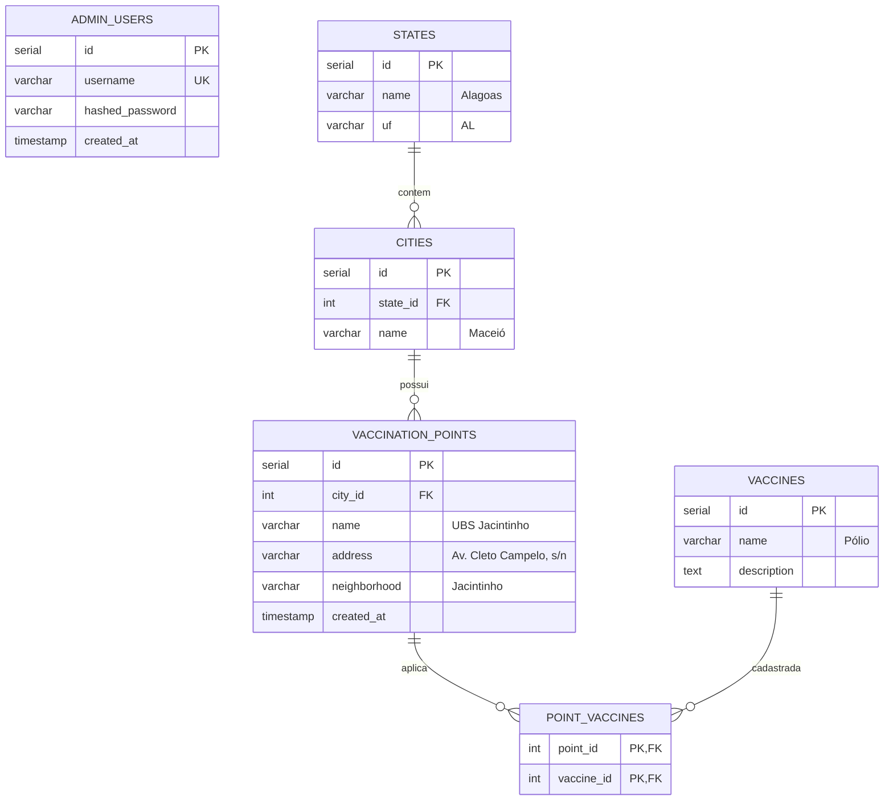
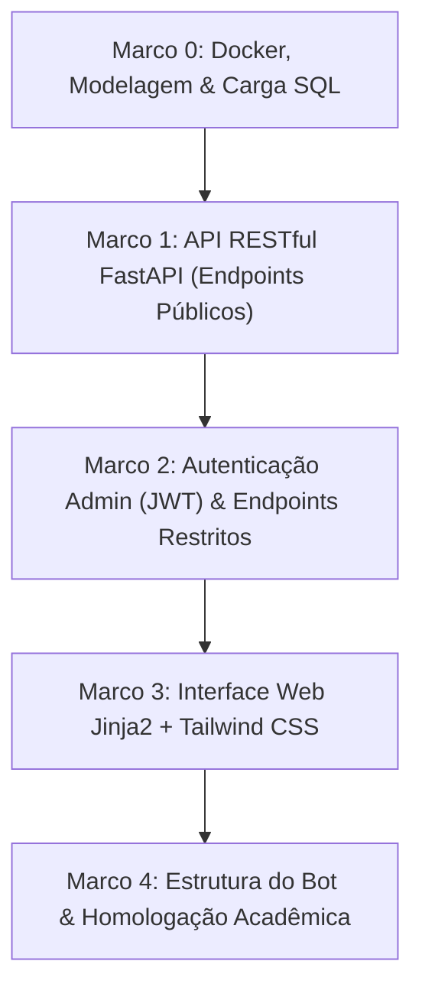

# PRD & Especificação de Produto — Sistema de Consulta a Pontos de Vacinação em Alagoas
**Projeto Integrador IV - B · Vacinação**

| Documento | Versão | Status | Data |
| :--- | :--- | :--- | :--- |
| **PRD-PI4B-VAC** | `v2.0` | **Aprovado para Desenvolvimento** | 31/10/2026 |

---

## 1. Visão, Problema e Público

### 1.1. Visão do Produto
Disponibilizar uma plataforma web intuitiva e uma API REST estruturada para consulta pública e centralizada de postos de vacinação no estado de **Alagoas** (com ênfase na capital Maceió), conectada a um banco de dados relacional **PostgreSQL 16**, desenvolvida em **Python com FastAPI**, renderizada com **Jinja2 + Tailwind CSS**, orquestrada em contêineres **Docker** e protegida por **autenticação administrativa (JWT)** para gestão de dados.

### 1.2. O Problema
Cidadãos alagoanos enfrentam dispersão de dados ao buscar onde se imunizar: postos de saúde de atenção primária (UBS, USF e Centros de Vacinação) têm horários e ofertas de imunobiológicos específicos divulgados de maneira fragmentada. A plataforma centraliza essas informações em uma interface ágil de consulta por município.

### 1.3. Personas
- **Cidadão / Usuário Final (Primário):** Acessa anonimamente a plataforma para selecionar sua cidade (ex.: Maceió ou Arapiraca), visualizar as unidades de saúde cadastradas e verificar quais vacinas estão ofertadas.
- **Administrador do Sistema (Secundário):** Acessa área restrita autenticada para inserir, atualizar pontos de vacinação e gerenciar cargas de dados.
- **Banca Avaliadora / Docente (Terciário):** Avalia a aderência aos padrões de projeto de uma API RESTful, a modelagem no PostgreSQL, códigos HTTP semânticos, conteinerização Docker e integridade da apresentação.

### 1.4. Casos de Uso Principais
- **UC-01:** Listar municípios de Alagoas cadastrados na base de dados (`GET /cities`).
- **UC-02:** Obter dados cadastrais de um município selecionado via ID (`GET /cities/{id}`).
- **UC-03:** Listar os pontos de vacinação de um município específico com suas respectivas vacinas ofertadas (`GET /vaccination-points/{city_id}`).
- **UC-04:** Autenticar administrador via credenciais seguras para acesso ao painel de gestão (`POST /auth/login`).
- **UC-05:** Inserir novos pontos de vacinação e vacinas associadas por administrador autenticado (`POST /admin/vaccination-points`).

---

## 2. Metas, Não-Metas e Restrições

### 2.1. Metas do MVP
- Modelar e implementar o banco relacional PostgreSQL com hierarquia de 3 níveis: **Estado $\rightarrow$ Cidade $\rightarrow$ Ponto de Vacinação**, acrescido de tabela de usuários administradores (`admin_users`).
- Desenvolver e disponibilizar os 3 endpoints públicos obrigatórios com retornos estritamente em JSON e códigos de status HTTP semânticos (200, 400, 404, 422, 500).
- Prover módulo de autenticação administrativa via OAuth2 Bearer Token (JWT) e hashing seguro de senhas com `bcrypt`.
- Popular a base com dados verídicos de cidades alagoanas (Maceió e Arapiraca) e suas respectivas unidades (ex.: UBS Jacintinho, PAM Salgadinho, USF Ponta Verde).
- Disponibilizar interface gráfica (Frontend) em Jinja2 + Tailwind CSS que permita ao usuário selecionar a cidade e visualizar os postos e vacinas correspondentes em tempo real.
- Orquestrar a execução do banco PostgreSQL e da aplicação FastAPI via `docker-compose.yml`.

### 2.2. Não-Metas (Fora do Escopo do MVP)
- Não contemplará agendamento de consultas ou triagem online.
- Não exigirá autenticação/login para consulta pública pelo cidadão (acesso anônimo e aberto).
- Não controlará estoque de doses em tempo real (dados de vacinas disponíveis são cadastrais/informativos).

### 2.3. Restrições Técnicas Conhecidas
- **SGBD:** PostgreSQL 16 (relacional) conteinerizado.
- **Backend:** API REST própria em Python 3.11+ utilizando FastAPI e SQLAlchemy 2.0.
- **Frontend:** Jinja2 Templates estilizados com Tailwind CSS integrados à mesma aplicação.
- **Ambiente & Execução:** Orquestração completa de banco e aplicação via Docker & Docker Compose (`docker compose up --build`).
- **Escopo Geográfico:** Municípios de Alagoas (BR-AL).

---

## 3. Indicadores de Sucesso (KPIs)

| ID | Métrica | Método de Medição | Cenário de Referência | Meta do MVP | Meta Próxima Versão |
| :--- | :--- | :--- | :--- | :--- | :--- |
| **KPI-01** | Tempo de resposta da API | Latência média com cliente HTTP local (Thunder Client / Postman) | 100 requisições sequenciais locais | $p95 < 80\text{ ms}$ | $p95 < 50\text{ ms}$ |
| **KPI-02** | Conformidade de Contrato REST | Validação de esquema JSON dos 3 endpoints públicos | Execução de testes automatizados com `pytest` e `httpx` | 100% de conformidade com os slides | 100% de conformidade |
| **KPI-03** | Cobertura Geográfica Inicial | Contagem de registros no banco PostgreSQL | Carga inicial via `seed.sql` | $\ge 2$ cidades e $\ge 4$ pontos | Cobertura de $\ge 10$ cidades |
| **KPI-04** | Reprodutibilidade de Ambiente | Tempo para subir ambiente limpo via Docker Compose | Máquina limpa com Docker instalado | $< 2\text{ minutos}$ (`docker compose up`) | $< 1\text{ minuto}$ |

---

## 4. Requisitos Funcionais (RF) com Critérios de Aceite

### Módulo: Municípios (`cities`)

#### `RF-01`: Listagem Geral de Municípios
- **Descrição:** A API deve retornar a lista de cidades alagoanas disponíveis no sistema.
- **Endpoint:** `GET /cities`
- **Critério de Aceite:**
  - **Dado** que há cidades cadastradas no PostgreSQL,
  - **Quando** o cliente realiza uma requisição `GET /cities`,
  - **Então** o servidor responde com status `200 OK` e um array de objetos JSON contendo os campos `id` (inteiro) e `name` (string).
  - Se a tabela estiver vazia, retorna status `200 OK` com array vazio `[]`.

#### `RF-02`: Consulta de Detalhes do Município por Identificador
- **Descrição:** A API deve retornar as informações de um município a partir do seu `{id}`.
- **Endpoint:** `GET /cities/{id}`
- **Critério de Aceite:**
  - **Dado** um `{id}` válido existente (ex.: `1`),
  - **Quando** o cliente requisita `GET /cities/1`,
  - **Então** a API retorna status `200 OK` e o JSON `{ "id": 1, "name": "Maceió", "state": "Alagoas" }`.
  - **Se** o `{id}` não for encontrado no banco de dados, retorna status `404 Not Found` com `{ "detail": "Cidade não encontrada" }`.
  - **Se** o parâmetro `{id}` for alfanumérico ou inválido, retorna status `422 Unprocessable Entity` (validação Pydantic).

---

### Módulo: Pontos de Vacinação (`vaccination-points`)

#### `RF-03`: Consulta de Pontos de Vacinação por Cidade
- **Descrição:** A API deve retornar os locais de vacinação pertencentes à cidade informada em `{city_id}`, listando as vacinas ofertadas por cada unidade.
- **Endpoint:** `GET /vaccination-points/{city_id}`
- **Critério de Aceite:**
  - **Dado** um `{city_id}` válido existente (ex.: `1` para Maceió),
  - **Quando** o cliente requisita `GET /vaccination-points/1`,
  - **Então** a API responde com status `200 OK` e uma lista JSON contendo unidades com os campos `id` (inteiro), `name` (string), `neighborhood` (string), `address` (string) e `vaccines` (array de strings). Ex.: `[{ "id": 10, "name": "UBS Jacintinho", "neighborhood": "Jacintinho", "address": "Av. Cleto Campelo, s/n", "vaccines": ["Pólio", "Sarampo"] }]`.
  - **Se** o `{city_id}` não existir no cadastro de cidades, retorna status `404 Not Found` com `{ "detail": "Cidade especificada não existe" }`.
  - **Se** a cidade existir porém não tiver postos cadastrados, retorna status `200 OK` com lista vazia `[]`.
  - **Se** o parâmetro for inválido (não numérico), retorna status `422 Unprocessable Entity`.

---

### Módulo: Autenticação & Gestão Administrativa

#### `RF-04`: Autenticação de Administrador
- **Descrição:** Endpoint para validação de credenciais de administrador e geração de token de acesso Bearer JWT.
- **Endpoint:** `POST /auth/login`
- **Critério de Aceite:**
  - **Dado** usuário e senha válidos enviados via formulário `application/x-www-form-urlencoded`,
  - **Quando** submetido a `POST /auth/login`,
  - **Então** a API retorna status `200 OK` com `{ "access_token": "...", "token_type": "bearer" }`.
  - **Se** as credenciais forem incorretas, retorna status `401 Unauthorized`.

#### `RF-05`: Inserção Administrativa de Postos de Vacinação
- **Descrição:** Inserção de novos postos vinculados a uma cidade e catálogo de vacinas.
- **Endpoint:** `POST /admin/vaccination-points`
- **Critério de Aceite:**
  - **Dado** um token JWT válido no header `Authorization: Bearer <token>`,
  - **Quando** o administrador envia os dados do posto em JSON (`name`, `city_id`, `neighborhood`, `address`, `vaccine_ids`),
  - **Então** o registro é criado no banco PostgreSQL e retorna status `201 Created` com o objeto persistido.
  - **Se** a requisição não contiver token válido, retorna status `401 Unauthorized`.

---

### Módulo: Interface do Usuário (Frontend)

#### `RF-06`: Seleção de Cidade e Exibição de Postos (Jinja2 + Tailwind)
- **Descrição:** A interface web pública deve renderizar a página inicial com layout Tailwind CSS, carregar as opções de cidades, permitir a seleção pelo usuário e atualizar em tempo real os cartões dos postos de vacinação e vacinas.
- **Critério de Aceite:**
  - Ao carregar a página inicial (`/`), o seletor de municípios é exibido.
  - Ao selecionar "Maceió", os postos (ex.: UBS Jacintinho, PAM Salgadinho) são renderizados na tela em cards com badges visuais das vacinas em menos de 1 segundo.

---

## 5. Requisitos Não Funcionais (RNF)

- **RNF-01 (Padrão Arquitetural REST):** Recursos nomeados com substantivos no plural (`/cities`, `/vaccination-points`), uso do método HTTP `GET` para leitura, `POST` para criação e payload serializado em JSON.
- **RNF-02 (Integridade Relacional no SGBD):** Integridade imposta via chaves estrangeiras no PostgreSQL com cláusula `ON DELETE CASCADE`.
- **RNF-03 (CORS):** A API deve implementar middleware de CORS liberado para comunicação segura entre portas locais (`CORSMiddleware`).
- **RNF-04 (Tratamento de Exceções):** Nenhuma query ou stack trace do PostgreSQL deve ser exposta ao cliente em caso de erro interno; deve-se retornar `500 Internal Server Error` estruturado.
- **RNF-05 (Responsividade da Interface):** A tela deve ser legível e estilizada com Tailwind CSS tanto em navegadores desktop quanto em dispositivos móveis.
- **RNF-06 (Portabilidade & Docker):** Todo o ecossistema deve rodar via `docker compose up --build` sem dependências instaladas no sistema host, exceto o próprio Docker.

---

## 6. Segurança, Privacidade e Conformidade (LGPD)

- **Anonimização & Dados Abertos:** A aplicação consulta exclusivamente dados públicos institucionais de unidades de saúde e imunobiológicos disponibilizados pelo SUS/Prefeituras.
- **Ausência de Dados Pessoais Sensíveis:** Não são coletados CPFs, nomes, prontuários ou carteiras vacinais de cidadãos no MVP, eliminando riscos de privacidade sob a LGPD (Lei 13.709/2018).
- **Proteção Administrativa:** Acesso restrito a endpoints de mutação protegido por autenticação OAuth2 com JWT (algoritmo HS256) e senhas armazenadas com hash `bcrypt`.
- **Prevenção a Injeção de SQL:** Utilização obrigatória de queries parametrizadas via SQLAlchemy 2.0.

---

## 7. Decisões Arquiteturais e Justificativa de Padrões

| Padrão | Decisão | Justificativa Técnica |
| :--- | :--- | :--- |
| **Cliente-Servidor** | Frontend Web desacoplado da lógica de persistência | Separação de responsabilidades: o frontend cuida da renderização; a API FastAPI centraliza regras de negócio e acesso ao banco. |
| **Arquitetura em Camadas** | Rotas $\rightarrow$ Controladores $\rightarrow$ Serviços $\rightarrow$ Repositórios | Evita que queries SQL fiquem dispersas nas rotas da API, facilitando manutenção e testes. |
| **Padrão Repository** | Módulos dedicados para queries PostgreSQL | Isola o acesso a dados. Se o driver mudar, a regra de negócio permanece idêntica. |
| **Monólito Modular** | Backend unificado em processo único | Ideal para o escopo acadêmico do MVP, eliminando complexidade operacional de microsserviços. |
| **Conteinerização Docker** | Orquestração com Docker Compose | Garante reprodutibilidade de banco e API em qualquer máquina de apresentação da faculdade. |

---

## 8. Modelo Conceitual e Físico de Dados (PostgreSQL)

### 8.1. Diagrama Entidade-Relacionamento



### 8.2. Script DDL e Seed Inicial (Dados Reais de Maceió e Arapiraca)

```sql
-- Criação das Tabelas
CREATE TABLE IF NOT EXISTS admin_users (
    id SERIAL PRIMARY KEY,
    username VARCHAR(50) UNIQUE NOT NULL,
    hashed_password VARCHAR(255) NOT NULL,
    created_at TIMESTAMP WITH TIME ZONE DEFAULT CURRENT_TIMESTAMP
);

CREATE TABLE IF NOT EXISTS states (
    id SERIAL PRIMARY KEY,
    name VARCHAR(100) NOT NULL,
    uf CHAR(2) NOT NULL UNIQUE
);

CREATE TABLE IF NOT EXISTS cities (
    id SERIAL PRIMARY KEY,
    state_id INT NOT NULL REFERENCES states(id) ON DELETE CASCADE,
    name VARCHAR(120) NOT NULL
);

CREATE TABLE IF NOT EXISTS vaccination_points (
    id SERIAL PRIMARY KEY,
    city_id INT NOT NULL REFERENCES cities(id) ON DELETE CASCADE,
    name VARCHAR(150) NOT NULL,
    neighborhood VARCHAR(100),
    address VARCHAR(200),
    latitude DOUBLE PRECISION,
    longitude DOUBLE PRECISION,
    created_at TIMESTAMP WITH TIME ZONE DEFAULT CURRENT_TIMESTAMP,
    CONSTRAINT uq_city_point_name UNIQUE (city_id, name)
);

CREATE TABLE IF NOT EXISTS vaccines (
    id SERIAL PRIMARY KEY,
    name VARCHAR(100) NOT NULL UNIQUE,
    description TEXT
);

CREATE TABLE IF NOT EXISTS point_vaccines (
    point_id INT NOT NULL REFERENCES vaccination_points(id) ON DELETE CASCADE,
    vaccine_id INT NOT NULL REFERENCES vaccines(id) ON DELETE CASCADE,
    PRIMARY KEY (point_id, vaccine_id)
);

-- Carga Inicial (Seed) com Dados Reais
INSERT INTO states (id, name, uf) VALUES (1, 'Alagoas', 'AL') ON CONFLICT DO NOTHING;

INSERT INTO cities (id, state_id, name) VALUES 
(1, 1, 'Maceió'),
(2, 1, 'Arapiraca')
ON CONFLICT DO NOTHING;

INSERT INTO vaccines (id, name) VALUES
(1, 'Pólio'),
(2, 'Sarampo'),
(3, 'Covid-19'),
(4, 'Influenza'),
(5, 'BCG')
ON CONFLICT DO NOTHING;

INSERT INTO vaccination_points (id, city_id, name, neighborhood, address) VALUES
(10, 1, 'UBS Jacintinho', 'Jacintinho', 'Av. Cleto Campelo, s/n'),
(11, 1, 'PAM Salgadinho', 'Poço', 'Rua Mizael Domingues, s/n'),
(12, 1, 'USF Ponta Verde', 'Ponta Verde', 'Rua Dep. José Lages, 240'),
(20, 2, 'UBS Primavera Arapiraca', 'Primavera', 'Rua Brasília, 100')
ON CONFLICT DO NOTHING;

INSERT INTO point_vaccines (point_id, vaccine_id) VALUES
(10, 1), (10, 2), (10, 3),
(11, 1), (11, 2), (11, 3), (11, 4), (11, 5),
(12, 3), (12, 4),
(20, 1), (20, 4)
ON CONFLICT DO NOTHING;
```

---

## 9. Roadmap de Entrega e Definição de Pronto (DoD)



### Marco 0: Ambiente Docker & Banco PostgreSQL
- **Requisitos Cobertos:** RNF-02, RNF-06.
- **Definição de Pronto (DoD):** `docker-compose.yml` e scripts SQL prontos; comando `docker compose up -d db` inicializa o banco com as tabelas e dados verídicos de Maceió e Arapiraca.

### Marco 1: API REST FastAPI (Endpoints Públicos)
- **Requisitos Cobertos:** RF-01, RF-02, RF-03, RNF-01, RNF-03, RNF-04, KPI-01, KPI-02.
- **Definição de Pronto (DoD):** Endpoints `/cities`, `/cities/{id}` e `/vaccination-points/{city_id}` operacionais, respondendo em JSON serializado e validados com códigos 200, 404 e 422 via `/docs`.

### Marco 2: Autenticação de Administrador
- **Requisitos Cobertos:** RF-04, RF-05.
- **Definição de Pronto (DoD):** Endpoint `/auth/login` emitindo JWT Bearer e rotas de escrita protegidas contra acesso anônimo com status 401.

### Marco 3: Interface Web do Usuário (Jinja2 + Tailwind)
- **Requisitos Cobertos:** RF-06, RNF-05.
- **Definição de Pronto (DoD):** Aplicação servindo tela inicial pública em HTML/Tailwind, permitindo alternar entre municípios e visualizar os postos e vacinas dinamicamente.

### Marco 4: Bot de Dados e Preparação da Avaliação
- **Requisitos Cobertos:** Módulo do Bot e Checklist acadêmico.
- **Definição de Pronto (DoD):** Estrutura do script de enriquecimento de dados criada e roteiro de apresentação validado.

---

## 10. Matriz de Riscos e Mitigações

| ID | Descrição do Risco | Probabilidade | Impacto | Mitigação |
| :--- | :--- | :--- | :--- | :--- |
| **RISCO-01** | Lentidão ou falha de porta ao rodar Docker em máquinas da faculdade | Média | Médio | Usar healthcheck no Docker Compose e mapear portas padrão (8000 e 5432) com flags de reinício. |
| **RISCO-02** | Dificuldade em estruturar o retorno aninhado de vacinas em SQL puro | Baixa | Baixo | Utilizar agregação SQL nativa com `COALESCE(array_agg(v.name), '{}')` diretamente no PostgreSQL. |
| **RISCO-03** | Erro de dependências de compilação Python no contêiner | Baixa | Médio | Usar imagem base `python:3.11-slim` com dependências de compilação documentadas no `Dockerfile`. |

---

## 11. Checklist de Avaliação e Conformidade do Projeto

| Item do Checklist da Disciplina | Situação | Evidência no Projeto |
| :--- | :---: | :--- |
| **Os três endpoints respondem corretamente** | Conforme | RF-01, RF-02 e RF-03 especificados e testáveis |
| **Os dados voltam em JSON** | Conforme | `Content-Type: application/json` garantido nativamente pelo FastAPI |
| **Escopo de Alagoas coberto (cidades e pontos)** | Conforme | Carga inicial no PostgreSQL com Maceió e Arapiraca |
| **Códigos de status fazem sentido (200, 404, 422, 500)** | Conforme | Mapeados na seção 4 para casos de sucesso e erro |
| **Decisões de arquitetura documentadas** | Conforme | Seção 7 detalha Cliente-Servidor, Camadas, Repository e Docker |
| **Padrões escolhidos e justificados** | Conforme | Justificativas técnicas presentes na Seção 7 |
| **Todos os integrantes no Conecte-se** | Em aberto | Ação operacional dos alunos na plataforma da faculdade |
| **Apresentação ao vivo ou vídeo gravado** | Roteirizado | Roteiro de demonstração de 5 minutos pronto na Seção 12 |

---

## 12. Roteiro de Apresentação / Vídeo Demonstrativo (5 minutos)

1. **Minuto 1 — Apresentação da Equipe e Contexto:** Apresentar os membros e explicar o problema: consulta simplificada a pontos de vacinação em Alagoas (foco em Maceió).
2. **Minuto 2 — Arquitetura, Docker e Banco de Dados:** Explicar a arquitetura em camadas, o padrão Repository, a execução com `docker compose up` e exibir o modelo relacional no PostgreSQL.
3. **Minuto 3 — Demonstração da API REST (Swagger `/docs`):**
   - Executar `GET /cities` (retornando lista JSON).
   - Executar `GET /cities/1` (Maceió) e testar um ID inexistente (exibindo o 404 Not Found).
   - Executar `GET /vaccination-points/1` (exibindo os postos com o array de vacinas).
4. **Minuto 4 — Demonstração da Interface Web & Painel Admin:**
   - Mostrar a interface Jinja2 + Tailwind carregando postos de Maceió e Arapiraca.
   - Demonstrar o login administrativo e a rota protegida.
5. **Minuto 5 — Conclusão:** Fechamento destacando o cumprimento de 100% dos critérios do checklist da disciplina.

---

## 13. Glossário

- **API REST (Representational State Transfer):** Arquitetura de comunicação web baseada em métodos HTTP e recursos bem definidos.
- **Docker & Docker Compose:** Plataforma de conteinerização e ferramenta de orquestração de múltiplos contêineres locais.
- **FastAPI:** Framework web moderno em Python com tipagem estática e geração automática de documentação OpenAPI.
- **Jinja2:** Motor de templates para Python que renderiza dados dinâmicos em arquivos HTML.
- **Tailwind CSS:** Framework CSS utility-first para criação ágil de interfaces modernas e responsivas.
- **JWT (JSON Web Token):** Padrão aberto (RFC 7519) para transmissão segura de informações autenticadas entre as partes.
