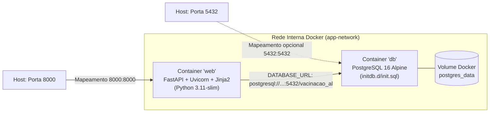
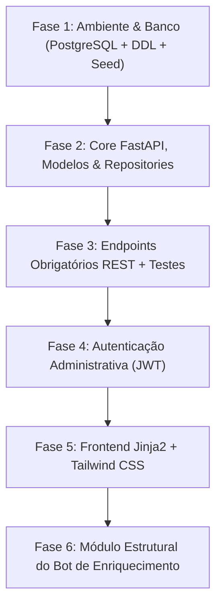

# TRD — Documento de Requisitos Técnicos & Arquitetura de Software
**Projeto Integrador IV - B · Sistema de Consulta a Pontos de Vacinação em Alagoas**

| Metadado | Detalhe |
| :--- | :--- |
| **Documento** | `TRD-PI4B-VAC` |
| **Versão** | `v1.1` |
| **Status** | **Aprovado para Implementação** |
| **Data** | 31/10/2026 |
| **PRD de Referência** | `PRD-PI4B-VAC v1.2` |
| **Stack Principal** | Python 3.11+, FastAPI, PostgreSQL 16, Docker & Docker Compose, SQLAlchemy / SQLModel, Jinja2, Tailwind CSS |

---

## 1. Resumo e Escopo Técnico

### 1.1. Objetivo Técnico
Especificar a arquitetura técnica, os contratos de API, o modelo relacional e os padrões de implementação para o **Sistema de Consulta a Pontos de Vacinação de Alagoas**. A aplicação será construída como um monólito modular em **Python 3 com FastAPI**, persistência em **PostgreSQL**, renderização server-side híbrida com **Jinja2 e Tailwind CSS**, além de autenticação de sessão/Bearer para usuários administradores e preparação arquitetural para um worker/bot assíncrono de enriquecimento de dados públicos.

### 1.2. O que está no Escopo
- API RESTful assíncrona expondo os endpoints obrigatórios: `GET /cities`, `GET /cities/{id}` e `GET /vaccination-points/{city_id}`.
- Interface Web responsiva renderizada via Jinja2 + Tailwind CSS (com Tailwind via CDN ou compilado localmente) e interatividade de troca de município.
- Módulo de autenticação administrativa (login seguro com hash de senha via `bcrypt`/`argon2`, geração de token JWT ou sessão assinada e proteção de rotas restritas de inserção e carga).
- Modelo de dados relacional normalizado no PostgreSQL e script de seed com dados verídicos de Maceió e Arapiraca.
- Estrutura desacoplada para suportar a ingestão e enriquecimento de dados via bot/script sem travar o event-loop da API.

### 1.3. O que está Fora do Escopo
- Autenticação e cadastro para o cidadão comum (a consulta pública aos postos é anônima).
- Aplicação nativa mobile (o foco é web responsiva).
- Sistema transacional de agendamento de consultas ou cartão de vacina do paciente.

---

## 2. Matriz de Rastreabilidade (PRD $\rightarrow$ Componentes Técnicos)

| Requisito do PRD | Componente Técnico | Decisão de Arquitetura (ADR) | Verificação Técnica |
| :--- | :--- | :--- | :--- |
| **RF-01** (`GET /cities`) | `COMP-01` (CityRouter / CityService) | `ADR-01`, `ADR-03` | Teste de integração HTTP 200 e validação de schema Pydantic |
| **RF-02** (`GET /cities/:id`) | `COMP-01` (CityRouter / CityRepository) | `ADR-01`, `ADR-03` | Testes com ID existente (200), inexistente (404) e alfanumérico (422/400) |
| **RF-03** (`GET /vaccination-points/:cityId`) | `COMP-02` (PointRouter / AggregationService) | `ADR-01`, `ADR-04` | Consulta SQL com agregação de array de vacinas (`array_agg`) e validação de 404 |
| **RF-04** (Frontend Jinja2/Tailwind) | `COMP-03` (WebUI / JinjaTemplates) | `ADR-02` | Teste E2E/manual de alternância de cidade em tela responsiva |
| **RNF-01** (Semântica REST) | `COMP-01`, `COMP-02` | `ADR-01` | Análise do esquema OpenAPI `/docs` gerado automaticamente pelo FastAPI |
| **RNF-02** (Integridade Relacional) | `COMP-04` (PostgreSQL Database Engine) | `ADR-03` | Verificação de chaves primárias e estrangeiras com `CASCADE` via migrations/DDL |
| **RNF-03** (CORS) | `COMP-05` (FastAPI Middleware Stack) | `ADR-01` | Teste com cabeçalhos `Origin` e `Access-Control-Allow-Origin` |
| **RNF-04** (Tratamento de Exceções) | `COMP-05` (Global Exception Handlers) | `ADR-01` | Injeção de erro de banco simulado retornando 500 sem stack trace |
| **Admin Auth** (Solicitado pelo Usuário) | `COMP-06` (AuthService & Security Guard) | `ADR-05` | Teste de tentativa de escrita sem token retornando 401 Unauthorized |
| **Data Bot** (Solicitado pelo Usuário) | `COMP-07` (Data Enrichment Bot Interface) | `ADR-06` | Script independente inserindo novos postos com idempotência |

---

## 3. Arquitetura do Sistema

### 3.1. Visão Geral dos Componentes e Fronteiras de Confiança

```mermaid
flowchart TD
    subgraph PublicZone ["Zona Pública (Não Autenticada)"]
        UserBrowser["Navegador do Cidadão"]
        ExtAPIClient["Cliente HTTP Externo (cURL/Postman)"]
    end

    subgraph AdminZone ["Zona Administrativa (Autenticada)"]
        AdminBrowser["Navegador do Administrador"]
        DataBot["Bot de Enriquecimento de Dados"]
    end

    subgraph AppMonolith ["Aplicação FastAPI (Monólito Modular)"]
        direction TB
        CORS["Middleware CORS & Exception Handler"]
        JinjaEng["COMP-03: Jinja2 Template Engine (Tailwind CSS)"]
        
        subgraph APIRouters ["Roteadores REST (FastAPI)"]
            PublicRouter["COMP-01 / COMP-02: Public Endpoints\n(/cities, /vaccination-points)"]
            AdminRouter["COMP-06: Admin Endpoints\n(/auth/login, /admin/cities, /admin/points)"]
        end
        
        AuthGuard["Security Guard (JWT / OAuth2PasswordBearer)"]
        
        subgraph CoreLayers ["Camada de Negócio e Acesso"]
            Services["Services (Regras & Agregações)"]
            Repositories["Repositories (SQLAlchemy / Async Engine)"]
        end
    end

    subgraph Persistence ["Persistência de Dados"]
        PostgresDB[("COMP-04: Banco PostgreSQL")]
    end

    UserBrowser -->|HTTP GET (Páginas HTML)| JinjaEng
    UserBrowser -->|HTTP GET (JSON Fetch)| PublicRouter
    ExtAPIClient -->|HTTP GET /cities, /vaccination-points| PublicRouter
    
    AdminBrowser -->|POST /auth/login (Credenciais)| AdminRouter
    AdminBrowser -->|Bearer Token (Operações CRUD)| AdminRouter
    DataBot -->|Service Layer / Direct Insert Token| AdminRouter

    AdminRouter --> AuthGuard
    AuthGuard --> Services
    PublicRouter --> Services
    JinjaEng --> Services
    Services --> Repositories
    Repositories -->|Pool de Conexões assíncronas| PostgresDB
```

### 3.2. Responsabilidade dos Componentes

- **`COMP-01` (City Module):** Gerencia a recuperação e persistência de municípios. Não processa templates HTML.
- **`COMP-02` (Vaccination Point Module):** Gerencia postos de saúde e o relacionamento muitos-para-muitos com vacinas. Realiza a agregação dos imunobiológicos em lista plana.
- **`COMP-03` (WebUI Engine):** Renderiza as views em Jinja2 com estilização moderna Tailwind CSS, servindo as páginas `/` e `/admin`.
- **`COMP-04` (PostgreSQL Engine):** Garante atomicidade (ACID), integridade referencial com `ON DELETE CASCADE` e índices de consulta por chave estrangeira.
- **`COMP-05` (Middleware & Cross-Cutting):** Gerenciador de CORS, interceptador global de erros e padronização de respostas JSON.
- **`COMP-06` (Auth & Security):** Emissão e verificação de tokens JWT assinados via algoritmo HS256, hashing de senhas via `Passlib (bcrypt)` e injeção de dependência `Depends(get_current_admin)`.
- **`COMP-07` (Data Enrichment Bot):** Módulo modular em Python (`enrichment/bot.py`) planejado para consultar fontes públicas externas (APIs de dados abertos, scraping ou arquivos CSV do DataSUS/Prefeitura de Maceió) e disparar inserts idempotentes no PostgreSQL.

---

## 4. Decisões de Arquitetura (ADRs)

### `ADR-01`: Adoção do FastAPI como Framework Backend
- **Contexto:** Necessidade de criar uma API REST com alto desempenho, serialização JSON automática, documentação interativa e facilidade de integração com templates.
- **Alternativas:** Flask, Django, FastAPI.
- **Decisão:** FastAPI.
- **Justificativa:** Fornece tipagem estática rigorosa através do Pydantic v2, suporte nativo assíncrono (`async/await`), documentação Swagger/OpenAPI nativa em `/docs` (facilitando a avaliação da banca) e facilidade na injeção de dependências para autenticação e banco de dados.

### `ADR-02`: Renderização Web com Jinja2 e Tailwind CSS (Padrão Azul Petróleo & Platina)
- **Contexto:** O projeto exige exibição dos dados ao usuário final, mantendo a simplicidade de implantação sem a complexidade de um pipeline separado de build (como Next.js ou React SPA) para o MVP.
- **Alternativas:** React/Vite SPA desacoplado vs. Jinja2 Server-Side Templates com Tailwind CSS.
- **Decisão:** FastAPI com `Jinja2Templates` e Tailwind CSS utilizando a paleta oficial aprovada **Padrão 2 (Azul Petróleo `#164E63` + Fundo Platina `#D1D5DB` + Detalhes em Âmbar `#B45309`)**, com contraste Nível AAA da WCAG 2.1.
- **Justificativa:** Reduz a barreira operacional: um único comando roda tanto a API quanto a interface web na mesma porta, eliminando problemas de CORS na demonstração e facilitando a entrega acadêmica em uma única base de código.

### `ADR-03`: Camada de Persistência com SQLAlchemy 2.0 (ou SQLModel) e PostgreSQL
- **Contexto:** Acessar o banco de dados PostgreSQL aplicando o padrão **Repository** e garantindo validação de tipos.
- **Alternativas:** `psycopg2` puro com SQL cru vs. SQLAlchemy 2.0 Core/ORM vs. Tortoise ORM.
- **Decisão:** SQLAlchemy 2.0 com `psycopg` (ou `asyncpg`).
- **Justificativa:** Permite queries eficientes, mapeamento explícito das entidades e isolamento completo no padrão Repository, cumprindo o critério avaliativo dos slides sobre arquitetura em camadas.

### `ADR-04`: Agregação de Vacinas no Banco de Dados via SQL (`array_agg` / `json_agg`)
- **Contexto:** O endpoint `/vaccination-points/:cityId` exige que as vacinas venham como uma lista de strings (`"vaccines": ["Pólio", "Sarampo"]`), enquanto no banco relacional há uma tabela intermediária `point_vaccines`.
- **Alternativas:** 
  1. Problema $N+1$: Fazer 1 SELECT para postos e depois 1 SELECT para cada posto buscando vacinas no Python.
  2. JOIN único com agregação no PostgreSQL usando `COALESCE(array_agg(v.name), '{}')`.
- **Decisão:** Opção 2 (Agregação no banco).
- **Justificativa:** Performance muito superior, elimina o overhead de roundtrips no banco e entrega o dado no formato exato exigido pelo contrato da API.

### `ADR-05`: Autenticação Administrativa via JWT (JSON Web Tokens)
- **Contexto:** Usuários administradores precisam de acesso exclusivo para cadastrar cidades, postos e rodar cargas de dados, mantendo a consulta pública livre.
- **Alternativas:** Sessão baseada em cookies vs. HTTP Basic Auth vs. OAuth2 com JWT Bearer Token.
- **Decisão:** OAuth2 Password Bearer com tokens JWT assinados (HS256).
- **Justificativa:** Padrão de mercado para APIs REST, perfeitamente suportado pela interface do Swagger (`/docs` traz o botão "Authorize" nativo para o professor testar) e desacoplado de estado de sessão no servidor.

### `ADR-06`: Bot de Enriquecimento Desacoplado via Script CLI / Background Task
- **Contexto:** O usuário planeja implementar um bot para minerar/coletar mais postos e enriquecer o banco de dados.
- **Alternativas:** Executar scraping síncrono dentro da requisição HTTP vs. Script CLI independente reutilizando a camada de serviço/repositório.
- **Decisão:** Script CLI modular (`python -m app.enrichment.bot`) que consome o `VaccinationPointService`.
- **Justificativa:** Não bloqueia as threads do servidor web, pode ser agendado via cron/tarefa periódica e insere dados respeitando as regras de integridade do sistema.

### `ADR-07`: Conteinerização e Orquestração Local com Docker e Docker Compose
- **Contexto:** Necessidade de padronizar os ambientes de desenvolvimento, execução e apresentação da banca acadêmica, garantindo que o PostgreSQL e a API FastAPI subam de forma idêntica em qualquer sistema operacional sem exigir instalação manual de banco local.
- **Alternativas:** Instalação manual de PostgreSQL nativo no host vs. Vagrant VM vs. Docker & Docker Compose.
- **Decisão:** Docker multi-estágio (`Dockerfile`) para a aplicação Python e `docker-compose.yml` para orquestração de dois serviços (`db` com PostgreSQL 16 Alpine e `web` com FastAPI/Uvicorn).
- **Justificativa:** 
  1. Reprodutibilidade total: um comando (`docker compose up --build`) inicializa banco, executa migrations/seed e sobe o servidor web.
  2. Isolamento de rede: banco e API comunicam-se via rede interna de bridge criada pelo Compose.
  3. Volume persistente: os dados de Maceió/Alagoas permanecem salvos entre reinicializações no volume `postgres_data`.

---

## 5. Contratos de API e Especificação Técnica

### 5.1. Endpoints Públicos

#### `GET /cities`
- **Descrição:** Lista todos os municípios de Alagoas cadastrados.
- **Headers:** `Accept: application/json`
- **Resposta 200 OK:**
```json
[
  {
    "id": 1,
    "name": "Maceió"
  },
  {
    "id": 2,
    "name": "Arapiraca"
  }
]
```

#### `GET /cities/{id}`
- **Descrição:** Retorna os detalhes de um município específico.
- **Parâmetro de Caminho:** `id` (int, obrigatório)
- **Resposta 200 OK:**
```json
{
  "id": 1,
  "name": "Maceió",
  "state": "Alagoas"
}
```
- **Resposta 404 Not Found:**
```json
{
  "detail": "Cidade não encontrada"
}
```
- **Resposta 422 Unprocessable Entity:** Caso `id` não seja um número inteiro válido.

#### `GET /vaccination-points/{city_id}`
- **Descrição:** Lista os pontos de vacinação pertencentes a uma cidade específica, acompanhados de suas vacinas.
- **Parâmetro de Caminho:** `city_id` (int, obrigatório)
- **Resposta 200 OK:**
```json
[
  {
    "id": 10,
    "name": "UBS Jacintinho",
    "neighborhood": "Jacintinho",
    "address": "Av. Cleto Campelo, s/n",
    "vaccines": ["Pólio", "Sarampo", "Covid-19"]
  },
  {
    "id": 11,
    "name": "PAM Salgadinho",
    "neighborhood": "Poço",
    "address": "Rua Mizael Domingues, s/n",
    "vaccines": ["BCG", "Hepatite B", "Febre Amarela", "Influenza"]
  }
]
```
- **Resposta 404 Not Found:** Cidade não localizada no banco de dados.

---

### 5.2. Endpoints Administrativos (Autenticados)

#### `POST /auth/login`
- **Descrição:** Autentica o administrador e emite o token Bearer.
- **Content-Type:** `application/x-www-form-urlencoded`
- **Body:** `username=admin` & `password=******`
- **Resposta 200 OK:**
```json
{
  "access_token": "eyJhbGciOiJIUzI1NiIsInR5cCI6IkpXVCJ9...",
  "token_type": "bearer"
}
```

#### `POST /admin/vaccination-points`
- **Descrição:** Criação de novo posto de vacinação com vacinas associadas.
- **Headers:** `Authorization: Bearer <token>`, `Content-Type: application/json`
- **Body:**
```json
{
  "city_id": 1,
  "name": "USF Ponta da Terra",
  "neighborhood": "Ponta da Terra",
  "address": "Rua Firmino Vasconcelos, 120",
  "vaccine_ids": [1, 3, 4]
}
```
- **Resposta 201 Created:** Retorna o objeto criado com seu `id` gerado.

---

## 6. Modelo de Dados Físico (PostgreSQL)

### 6.1. DDL Completo com Índices de Otimização

```sql
-- Extensões e Criação de Tabelas
CREATE TABLE IF NOT EXISTS admin_users (
    id SERIAL PRIMARY KEY,
    username VARCHAR(50) UNIQUE NOT NULL,
    hashed_password VARCHAR(255) NOT NULL,
    created_at TIMESTAMP WITH TIME ZONE DEFAULT CURRENT_TIMESTAMP
);

CREATE TABLE IF NOT EXISTS states (
    id SERIAL PRIMARY KEY,
    name VARCHAR(100) NOT NULL,
    uf CHAR(2) NOT NULL UNIQUE
);

CREATE TABLE IF NOT EXISTS cities (
    id SERIAL PRIMARY KEY,
    state_id INT NOT NULL REFERENCES states(id) ON DELETE CASCADE,
    name VARCHAR(120) NOT NULL
);
CREATE INDEX IF NOT EXISTS idx_cities_state ON cities(state_id);

CREATE TABLE IF NOT EXISTS vaccination_points (
    id SERIAL PRIMARY KEY,
    city_id INT NOT NULL REFERENCES cities(id) ON DELETE CASCADE,
    name VARCHAR(150) NOT NULL,
    neighborhood VARCHAR(100),
    address VARCHAR(200),
    latitude DOUBLE PRECISION,
    longitude DOUBLE PRECISION,
    created_at TIMESTAMP WITH TIME ZONE DEFAULT CURRENT_TIMESTAMP,
    CONSTRAINT uq_city_point_name UNIQUE (city_id, name)
);
CREATE INDEX IF NOT EXISTS idx_vaccination_points_city ON vaccination_points(city_id);

CREATE TABLE IF NOT EXISTS vaccines (
    id SERIAL PRIMARY KEY,
    name VARCHAR(100) NOT NULL UNIQUE,
    description TEXT
);

CREATE TABLE IF NOT EXISTS point_vaccines (
    point_id INT NOT NULL REFERENCES vaccination_points(id) ON DELETE CASCADE,
    vaccine_id INT NOT NULL REFERENCES vaccines(id) ON DELETE CASCADE,
    PRIMARY KEY (point_id, vaccine_id)
);
CREATE INDEX IF NOT EXISTS idx_point_vaccines_vaccine ON point_vaccines(vaccine_id);
```

### 6.2. Query de Agregação de Alta Eficiência (Padrão Repository)

```sql
SELECT 
    vp.id,
    vp.name,
    vp.neighborhood,
    vp.address,
    COALESCE(array_agg(v.name) FILTER (WHERE v.name IS NOT NULL), '{}') AS vaccines
FROM vaccination_points vp
LEFT JOIN point_vaccines pv ON vp.id = pv.point_id
LEFT JOIN vaccines v ON pv.vaccine_id = v.id
WHERE vp.city_id = :city_id
GROUP BY vp.id, vp.name, vp.neighborhood, vp.address
ORDER BY vp.name ASC;
```

---

## 7. Orçamentos de Requisitos Não Funcionais (NFR)

| ID | Origem no PRD | Métrica | Valor-Alvo | Ponto de Medição | Cenário de Referência | Como Medir |
| :--- | :--- | :--- | :--- | :--- | :--- | :--- |
| **NFR-01** | KPI-01 | Latência de resposta | $p95 < 80\text{ ms}$ | Servidor FastAPI $\rightarrow$ Retorno HTTP | 50 req/s em loopback local | Teste de carga com `pytest-benchmark` ou Apache Bench (`ab`) |
| **NFR-02** | RNF-02 | Integridade referencial | 100% | Banco PostgreSQL | Deleção em cascata de cidade | Teste unitário de exclusão com constraints ativas |
| **NFR-03** | RNF-04 | Taxa de vazamento de stacktrace | 0% | Resposta JSON em erro 500 | Erro simulado de conexão SQL | Teste de integração com handler customizado |
| **NFR-04** | Admin Auth | Tempo de hashing de senha | $150\text{ ms} \pm 50\text{ ms}$ | `pwd_context.hash()` | 1 execução de hash de senha | Benchmark interno do módulo passlib (bcrypt rounds=12) |

---

## 8. Segurança e Modelo de Ameaças

```mermaid
flowchart LR
    Attacker["Atacante Externo"]
    InternetBoundary["(Fronteira Externa)"]
    API["FastAPI / Uvicorn"]
    AuthModule["Módulo de Auth (JWT)"]
    DB[("PostgreSQL")]

    Attacker -.->|1. Tentativa de SQL Injection| API
    Attacker -.->|2. Brute Force no Login Admin| API
    Attacker -.->|3. Acesso indevido a dados de cidadãos| API

    API -->|Mitigação 1: ORM / Parametrized Queries| DB
    API -->|Mitigação 2: Bcrypt + Rate Limiter simples| AuthModule
    API -->|Mitigação 3: Não aplicável (Apenas dados públicos de UBSs)| DB
```

1. **Proteção contra Injeção de SQL:** Todas as queries são construídas usando SQLAlchemy Core/ORM ou parâmetros vinculados (`:param`). Nenhuma interpolação direta de strings (`f"SELECT ... {id}"`) é permitida.
2. **Armazenamento Seguro de Credenciais:** Senhas de administradores nunca são salvas em texto plano; utiliza-se `bcrypt` com salt automático.
3. **Gestão de Segredos:** A chave de assinatura do JWT (`SECRET_KEY`) e as credenciais do banco (`DATABASE_URL`) são lidas estritamente de variáveis de ambiente (`.env`) gerenciadas pelo `pydantic-settings`.
4. **Proteção de Rotas:** O decorator de injeção de dependência `Depends(oauth2_scheme)` bloqueia qualquer escrita não autorizada.

---

## 9. Design do Bot de Enriquecimento de Dados (`COMP-07` — Integração OpenStreetMap / Overpass API)

### 9.1. Arquitetura e Fonte de Dados (Overpass QL)
O módulo de enriquecimento utiliza a **Overpass API** do **OpenStreetMap (OSM)** como fonte oficial de dados abertos para unidades de saúde (`amenity=clinic` e `healthcare=centre`) do município de Maceió (`admin_level=8`).

```mermaid
flowchart TD
    OverpassAPI["Overpass API (OpenStreetMap)\nURL: overpass-api.de/api/interpreter"] -->|POST Overpass QL (Nodes & Ways)| BotWorker["COMP-07: Bot Extrator (app/enrichment/bot.py)"]
    BotWorker -->|Sanitização & Normalização (addr:street, addr:suburb, lat/lon)| Normalizer["Data Normalizer & Deduplicator"]
    Normalizer -->|Upsert Idempotente (ON CONFLICT)| PointRepo["VaccinationPointRepository (SQLAlchemy)"]
    PointRepo -->|Persistência em Lote| PostgresDB[("PostgreSQL 16\nvaccination_points")]
```

### 9.2. Query de Extração e Estratégia de Ingestão
```text
[out:json];
area["name"="Maceió"]["admin_level"="8"]->.searchArea;
(
  node["amenity"="clinic"](area.searchArea);
  way["amenity"="clinic"](area.searchArea);
  node["healthcare"="centre"](area.searchArea);
  way["healthcare"="centre"](area.searchArea);
);
out center;
```

### 9.3. Princípios de Implementação do Bot
1. **Unificação Georreferenciada:** Tratamento automático de coordenadas para `nodes` (`lat`/`lon`) e `ways` (`center.lat`/`center.lon`).
2. **Idempotência no PostgreSQL:** A inserção no banco utiliza restrição única ou cláusula `ON CONFLICT (city_id, name) DO NOTHING/UPDATE`, evitando duplicar UBSs já existentes (ex.: UBS Jacintinho).
3. **Associação Padrão de Imunobiológicos:** Para postos inseridos via OSM sem catálogo vacinal detalhado no mapa, o bot vincula automaticamente o kit de imunização básica da atenção primária (Pólio, Sarampo, Covid-19, Influenza).
4. **Acionamento Duplo:**
   - **CLI Independente:** Executável via terminal: `python -m app.enrichment.bot`.
   - **Endpoint Administrativo Autenticado:** Disparado pelo painel com token JWT em segundo plano via `BackgroundTasks` do FastAPI (`POST /admin/enrichment/sync-osm`).

---

## 10. Operação, Implantação e Especificação Docker

### 10.1. Topologia de Contêineres (Docker Compose)

A infraestrutura local é orquestrada através do `docker-compose.yml`, separando o banco de dados e a aplicação em serviços independentes:



### 10.2. Especificação do `docker-compose.yml`

```yaml
version: '3.8'

services:
  db:
    image: postgres:16-alpine
    container_name: vacinacao_pg_db
    restart: always
    environment:
      POSTGRES_USER: ${POSTGRES_USER:-postgres}
      POSTGRES_PASSWORD: ${POSTGRES_PASSWORD:-postgres}
      POSTGRES_DB: ${POSTGRES_DB:-vacinacao_al}
    ports:
      - "5432:5432"
    volumes:
      - postgres_data:/var/lib/postgresql/data
      - ./sql/init.sql:/docker-entrypoint-initdb.d/01-init.sql
      - ./sql/seed.sql:/docker-entrypoint-initdb.d/02-seed.sql
    networks:
      - vacinacao-network
    healthcheck:
      test: ["CMD-SHELL", "pg_isready -U postgres -d vacinacao_al"]
      interval: 5s
      timeout: 5s
      retries: 5

  web:
    build:
      context: .
      dockerfile: Dockerfile
    container_name: vacinacao_fastapi_app
    restart: always
    environment:
      DATABASE_URL: postgresql+asyncpg://${POSTGRES_USER:-postgres}:${POSTGRES_PASSWORD:-postgres}@db:5432/${POSTGRES_DB:-vacinacao_al}
      SECRET_KEY: ${SECRET_KEY:-supersecretkeyparaavaliacaodafaculdade2026}
      ADMIN_USERNAME: ${ADMIN_USERNAME:-admin}
      ADMIN_PASSWORD: ${ADMIN_PASSWORD:-admin123}
    ports:
      - "8000:8000"
    volumes:
      - ./app:/app/app # Live reload em desenvolvimento
    depends_on:
      db:
        condition: service_healthy
    networks:
      - vacinacao-network

volumes:
  postgres_data:
    driver: local

networks:
  vacinacao-network:
    driver: bridge
```

### 10.3. Especificação do `Dockerfile` da Aplicação

```dockerfile
FROM python:3.11-slim

# Evita criação de arquivos .pyc e força flush imediato de stdout/stderr
ENV PYTHONDONTWRITEBYTECODE=1
ENV PYTHONUNBUFFERED=1

WORKDIR /app

# Instalação de dependências de compilação mínimas caso necessário
RUN apt-get update && apt-get install -y --no-install-recommends \
    curl \
    && rm -rf /var/lib/apt/lists/*

COPY requirements.txt .
RUN pip install --no-cache-dir -r requirements.txt

COPY . .

EXPOSE 8000

CMD ["uvicorn", "app.main:app", "--host", "0.0.0.0", "--port", "8000", "--reload"]
```

---

## 11. Estrutura do Código-Fonte do Projeto (Backend & Frontend Separados)

A organização segue o padrão corporativo com separação estrita de camadas e pastas:

```text
Projeto Integrador IV-B/
├── backend/                    # Módulo do Backend e API REST (Python / FastAPI)
│   ├── src/                    # Código-fonte principal da aplicação
│   │   ├── app/                # Inicialização da API e configurações globais
│   │   │   ├── config.py       # Gerenciamento de variáveis de ambiente (.env)
│   │   │   └── main.py         # Ponto de entrada (instanciação do FastAPI)
│   │   │
│   │   ├── api/                # Camada de transporte (Rotas e Endpoints)
│   │   │   ├── v1/             # Versionamento da API
│   │   │   │   ├── endpoints/  # Arquivos de rotas separados por domínio
│   │   │   │   │   ├── auth.py
│   │   │   │   │   ├── cities.py
│   │   │   │   │   ├── points.py
│   │   │   │   │   └── enrichment.py
│   │   │   │   └── api.py      # Centralizador das rotas da v1
│   │   │   └── views.py        # Rotas de renderização de páginas Jinja2
│   │   │
│   │   ├── core/               # Regras de Negócio e Serviços (Services)
│   │   │   ├── security.py     # Criptografia, geração e validação de JWT
│   │   │   └── services/       # Casos de uso e lógica de negócio pura
│   │   │       ├── city_service.py
│   │   │       ├── point_service.py
│   │   │       └── enrichment_service.py # Bot Extrator OpenStreetMap (Overpass API)
│   │   │
│   │   ├── database/           # Camada de Dados (Persistência)
│   │   │   ├── connection.py   # Criação da sessão do Banco de Dados / ORM
│   │   │   └── models/         # Modelos de tabela do banco (SQLAlchemy)
│   │   │       ├── base.py
│   │   │       └── entities.py
│   │   │
│   │   ├── schemas/            # Validação de dados (Pydantic DTOs)
│   │   │   ├── auth.py         # DTOs para login e tokens
│   │   │   ├── city.py         # DTOs de cidades
│   │   │   └── point.py        # DTOs de postos de vacinação
│   │   │
│   │   └── utils/              # Utilitários gerais
│   │
│   ├── tests/                  # Testes automatizados (Pytest)
│   │   ├── api/
│   │   └── services/
│   │
│   ├── migrations/             # Scripts de migração de banco
│   ├── Dockerfile              # Imagem do Backend FastAPI
│   └── requirements.txt        # Dependências Python
│
├── frontend/                   # Módulo do Frontend Web (Jinja2 + Tailwind CSS)
│   └── templates/              # Templates HTML com WCAG 2.1 AA (Padrão 2 Aprovado)
│       ├── base.html           # Layout mestre em Azul Petróleo (#164E63)
│       ├── index.html          # Consulta pública ao cidadão com filtro assíncrono
│       └── admin.html          # Painel administrativo com login e disparo de bot
│
├── sql/                        # Scripts SQL do PostgreSQL 16
│   ├── init.sql                # DDL de criação de tabelas e índices
│   └── seed.sql                # Carga inicial com dados de Maceió e Arapiraca
│
├── .dockerignore
├── .env.example
├── docker-compose.yml          # Orquestração local (db + web)
├── paletas_wireframe.html      # Comparativo das paletas visuais
├── PRD_PROJETO_INTEGRADOR_IV_B.md
├── TRD_PROJETO_INTEGRADOR_IV_B.md
├── WIREFRAME_UI_WCAG.md
└── README.md
```

---

## 11. Estratégia de Testes

### 11.1. Testes Automatizados com `pytest` e `httpx`
- **Testes de Integração de API:**
  - `test_get_cities()`: Assegura retorno 200 e lista contendo Maceió e Arapiraca.
  - `test_get_city_by_id()`: Assegura retorno 200 para `id=1` e 404 para `id=9999`.
  - `test_get_vaccination_points()`: Assegura retorno 200 e formato correto do array `vaccines`.
  - `test_admin_auth_guard()`: Garante que POST em rotas admin sem token retorne 401.

### 11.2. Banco de Teste
- Os testes rodam contra uma base PostgreSQL de teste isolada ou banco em memória SQLite/Testcontainers, garantindo idempotência e execução sem efeitos colaterais.

---

## 12. Plano de Implementação Técnica



1. **Fase 1 — Persistência:** Configuração do `.env`, criação das tabelas e execução do `seed.sql`.
2. **Fase 2 — Arquitetura Base:** Configuração do SQLAlchemy e injeção de dependência de sessão no FastAPI.
3. **Fase 3 — Endpoints REST:** Implementação dos 3 endpoints do PRD (`/cities`, `/cities/{id}`, `/vaccination-points/{city_id}`).
4. **Fase 4 — Auth Admin:** Rota `/auth/login`, hashing com bcrypt e proteção com `Depends(get_current_admin)`.
5. **Fase 5 — Interface do Usuário:** Criação da view principal em Jinja2 com layout limpo e responsivo em Tailwind CSS consumindo os endpoints.
6. **Fase 6 — Bot de Enriquecimento:** Criação do worker CLI `app/enrichment/bot.py`.
