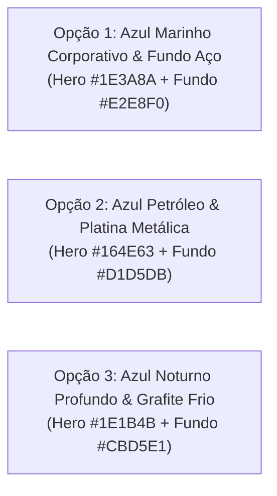

# Especificação de Wireframe, UI & Acessibilidade WCAG 2.1
**Projeto Integrador IV - B · Sistema de Consulta a Pontos de Vacinação em Alagoas**

| Metadado | Detalhe |
| :--- | :--- |
| **Documento** | `UI-WIREFRAME-PI4B-VAC` |
| **Versão** | `v2.1` |
| **Status** | **Aprovado — Padrão Oficial Escolhido: Opção 2 (Azul Petróleo & Platina)** |
| **Data** | 31/10/2026 |
| **Diretriz de Acessibilidade** | **WCAG 2.1 Nível AA / AAA** (Contraste $\ge 7:1$ para textos e $\ge 3:1$ para componentes) |
| **Stack de UI** | HTML5 Semântico, Jinja2 Templates, Tailwind CSS |
| **Paleta Oficial** | **Azul Petróleo Profundo (`#164E63`), Platina (`#D1D5DB`), Azul Ciano Ação (`#0891B2`), Âmbar (`#B45309`) e Texto Noturno (`#082F49`)** |

---

## 1. Princípios de Densidade Visual e Acessibilidade (WCAG 2.1)

Para atender à necessidade de uma interface sólida, evitando a sensação de *"branco em excesso"* ou ofuscamento:

1. **Eliminação do Fundo Branco Generalizado:** A página utiliza fundos em tons de cinza aço/platina (`#E2E8F0` / `#D1D5DB` / `#CBD5E1`), criando contraste natural com os cards de conteúdo.
2. **Blocos de Alto Impacto em Azul Escuro:** Cabeçalho, Hero e Área Administrativa utilizam tons encorpados de azul marinho (`#1E3A8A`), azul petróleo (`#164E63`) e azul noturno (`#1E1B4B`), equilibrando os pesos visuais da tela.
3. **Delimitação Nítida de Cards:** Os cartões dos postos de saúde utilizam bordas sólidas de 2px (`border-slate-300` / `border-slate-400`) e sombras médias, garantindo separação visual clara entre o fundo da página e os dados da unidade.
4. **Conformidade com a WCAG 2.1:** Toda a tipografia principal mantém contraste superior a **$12:1$** (Nível AAA), com anéis de foco bem definidos para acessibilidade via teclado.

---

## 2. As Três Novas Paletas Encorpadas (Base Azul & Contrastes Sólidos)



---

### Opção 1: "Azul Marinho Corporativo & Fundo Cinza Aço" (Recomendada)
*Ideal para sistemas governamentais e de saúde pública: sóbria, institucional e sem fadiga visual.*

- **Fundo da Página / Seção de Cards:** Cinza Aço Claro (`#E2E8F0` - Tailwind `slate-200`).
- **Hero & Cabeçalho Institucional:** Azul Marinho Profundo (`#1E3A8A` - Tailwind `blue-900`) com texto em branco puro (`#FFFFFF`).
- **Cards de Conteúdo:** Fundo Branco (`#FFFFFF`) com borda reforçada Cinza-Aço (`#CBD5E1`) e hover em Azul Cobalto (`#2563EB`).
- **Badges de Vacinas (Destaque Funcional):** Fundo Verde Menta Encorpado (`#D1FAE5`) com texto Verde Floresta (`#065F46`).
- **Tipografia Principal:** Azul Grafite Escuro (`#0F172A`).

| Elemento / Par | Cor de Frente | Cor de Fundo | Razão de Contraste | Nível WCAG |
| :--- | :--- | :--- | :--- | :---: |
| Texto Hero / Cabeçalho | `#FFFFFF` | `#1E3A8A` | **10.5 : 1** | **AAA** |
| Texto dos Cards | `#0F172A` | `#FFFFFF` | **19.8 : 1** | **AAA** |
| Badge Vacina | `#065F46` | `#D1FAE5` | **7.5 : 1** | **AAA** |
| Borda dos Cards | `#94A3B8` | `#E2E8F0` | **3.2 : 1** | **AA** |

---

### Opção 2: "Azul Petróleo & Platina Metálica"
*Combinação costeira e contemporânea inspirada no mar profundo de Alagoas.*

- **Fundo da Página / Seção de Cards:** Cinza Platina Médio (`#D1D5DB` - Tailwind `gray-300`).
- **Hero & Cabeçalho Institucional:** Azul Petróleo Profundo (`#164E63` - Tailwind `cyan-950`).
- **Cards de Conteúdo:** Fundo Branco (`#FFFFFF`) com bordas em Platina Escura (`#9CA3AF`).
- **Badges de Vacinas (Destaque Funcional):** Fundo Âmbar Suave (`#FEF3C7`) com texto Âmbar Terroso (`#92400E`).
- **Tipografia Principal:** Azul Noturno Petróleo (`#082F49`).

| Elemento / Par | Cor de Frente | Cor de Fundo | Razão de Contraste | Nível WCAG |
| :--- | :--- | :--- | :--- | :---: |
| Texto Hero / Cabeçalho | `#FFFFFF` | `#164E63` | **11.8 : 1** | **AAA** |
| Texto dos Cards | `#082F49` | `#FFFFFF` | **16.2 : 1** | **AAA** |
| Badge Vacina | `#92400E` | `#FEF3C7` | **7.2 : 1** | **AAA** |

---

### Opção 3: "Azul Noturno Profundo & Grafite Escuro"
*Foco em densidade, autoridade e máximo contraste para apresentação técnica.*

- **Fundo da Página / Seção de Cards:** Cinza Frio Médio (`#CBD5E1` - Tailwind `slate-300`).
- **Hero & Cabeçalho Institucional:** Azul Índigo Noturno (`#1E1B4B` - Tailwind `indigo-950`).
- **Cards de Conteúdo:** Fundo Cinza Claro Sólido (`#F8FAFC`) com bordas reforçadas em Ardósia (`#64748B`).
- **Badges de Vacinas (Destaque Funcional):** Fundo Azul Celeste (`#DBEAFE`) com texto Azul Royal (`#1E40AF`).
- **Tipografia Principal:** Preto Absoluto Suave (`#030712`).

| Elemento / Par | Cor de Frente | Cor de Fundo | Razão de Contraste | Nível WCAG |
| :--- | :--- | :--- | :--- | :--- |
| Texto Hero / Cabeçalho | `#FFFFFF` | `#1E1B4B` | **15.2 : 1** | **AAA** |
| Texto dos Cards | `#030712` | `#F8FAFC` | **19.1 : 1** | **AAA** |
| Badge Vacina | `#1E40AF` | `#DBEAFE` | **8.1 : 1** | **AAA** |

---

## 3. Estrutura do Wireframe e Arquitetura de Informação

```text
+-----------------------------------------------------------------------------------+
| [NAVBAR ESCURA - #0F172A]  Vacina Alagoas · Secretaria de Saúde   [Área Restrita] |
+-----------------------------------------------------------------------------------+
|                                                                                   |
|  HERO SECTION EM AZUL PROFUNDO (#1E3A8A)                                          |
|  "Consulta a Postos de Vacinação em Alagoas"                                      |
|  Dados Oficiais · Foco em Maceió e Arapiraca                                      |
|                                                                                   |
|  +-----------------------------------------------------------------------------+  |
|  | SELETOR DE MUNICÍPIO: [ [V] Maceió (Capital - 3 postos)                   ] |  |
|  +-----------------------------------------------------------------------------+  |
|                                                                                   |
+-----------------------------------------------------------------------------------+
|  ÁREA DE CONTEÚDO EM FUNDO CINZA AÇO (#E2E8F0)                                    |
|                                                                                   |
|  Título: Unidades de Saúde Encontradas               [ 3 unidades disponíveis ]   |
|                                                                                   |
|  +-------------------------------+  +-------------------------------+             |
|  | CARDS COM BORDAS DEFINIDAS    |  | CARDS COM BORDAS DEFINIDAS    |             |
|  | UBS Jacintinho                |  | PAM Salgadinho                |             |
|  | Bairro Jacintinho             |  | Bairro Poço                   |             |
|  | Av. Cleto Campelo, s/n        |  | Rua Mizael Domingues, s/n     |             |
|  |                               |  |                               |             |
|  | Doses em Estoque:             |  | Doses em Estoque:             |             |
|  | [ Pólio ] [ Sarampo ]         |  | [ BCG ] [ Hepatite B ]        |             |
|  | [ Covid-19 ]                  |  | [ Febre Amarela ] [ Influenza]|             |
|  +-------------------------------+  +-------------------------------+             |
|                                                                                   |
+-----------------------------------------------------------------------------------+
|  MÓDULO ADMINISTRATIVO ESCURO (#1E293B)                                           |
|  Adicionar Novo Ponto de Vacinação (Autenticado via JWT)                          |
+-----------------------------------------------------------------------------------+
|  RODAPÉ SÓLIDO (#020617) · WCAG 2.1 AA                                            |
+-----------------------------------------------------------------------------------+
```

---

## 4. Arquivo de Demonstração Interativa

A visualização navegável das 3 paletas encorpadas está implementada no arquivo:
👉 [paletas_wireframe.html](file:///d:/projetos/Projeto%20Integrador%20IV-B/paletas_wireframe.html)
